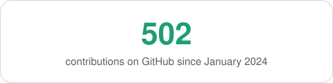

I love everything around AI and new technology: I experiment with it, use it every day and build whatever comes to mind.

  <picture>
    <source media="(prefers-color-scheme: dark)" srcset="https://raw.githubusercontent.com/aldikosh23/aldikosh23/output/contributions-dark.svg"/>
    <source media="(prefers-color-scheme: light)" srcset="https://raw.githubusercontent.com/aldikosh23/aldikosh23/output/contributions-light.svg"/>
    
  </picture>

### Contributed to

  
  

Contributor to <a href="https://github.com/krishhgg/Insomnia"><b>Insomnia</b></a>, a macOS API client: four merged pull requests covering macOS 27 defaults backstop handling, hotspot SSID rescanning with the other apostrophe, system-consistent Security error wording, and heat management that keeps Low Power Mode on until the battery is nominal.

### Repos

<!-- REPOS:START -->
<table>
  <tr><td width="33%" valign="top"><h4><a href="https://github.com/aldikosh23/primordial">primordial</a></h4>An evolution sandbox in your browser: predators and prey evolve speed, size, vision, diet and colour in real time.   <a href="https://aldikosh23.github.io/primordial/"><b>&#9654; live</b></a></td><td width="33%" valign="top"><h4><a href="https://github.com/aldikosh23/Foldglass">Foldglass</a></h4>a native macbook menu bar app that makes your screen follow the lid. swift, metal, and the real lid-angle sensor.   </td><td width="33%" valign="top"><h4><a href="https://github.com/aldikosh23/Macisland">Macisland</a></h4>A native macOS music island for the MacBook notch with playback controls, live audio spectrum, and synced lyrics.   </td></tr>
</table>
<!-- REPOS:END -->

### Tools I build with

  
  
  
  
  
  

